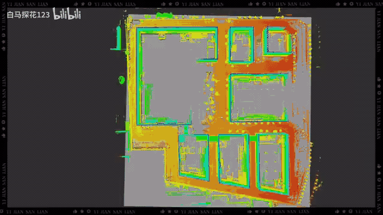
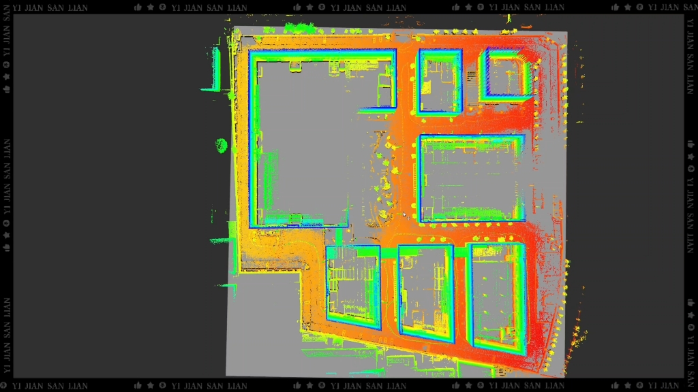
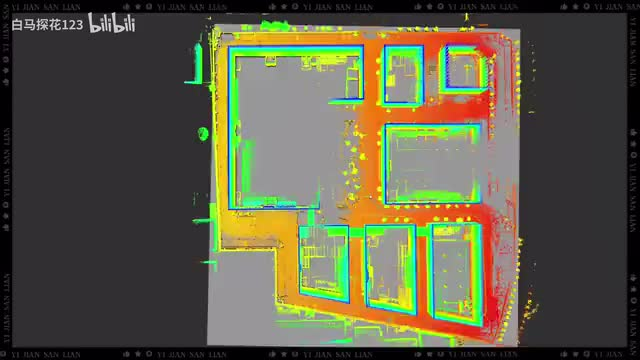
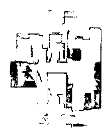
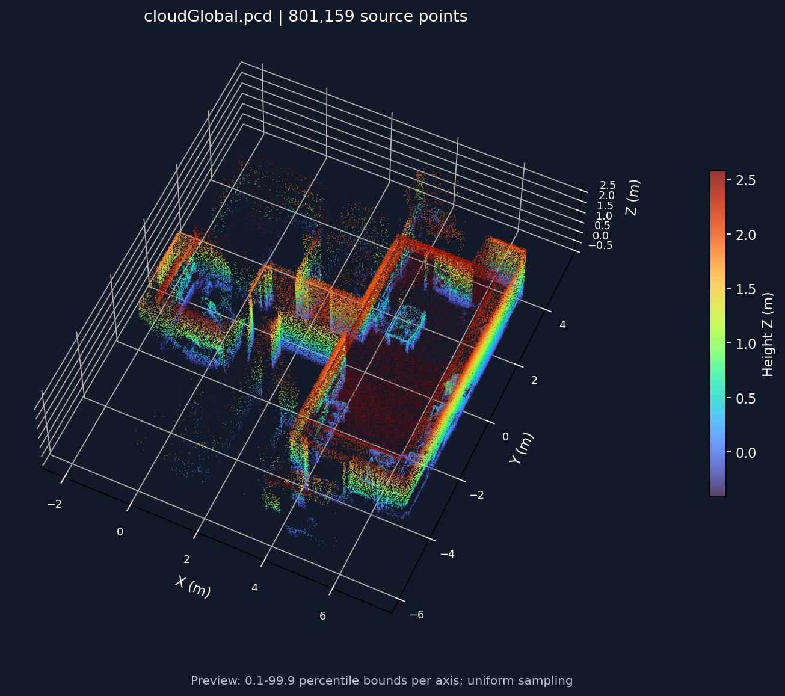
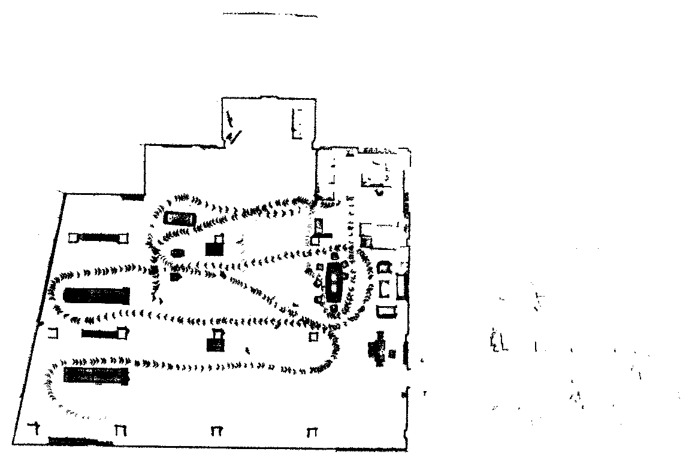
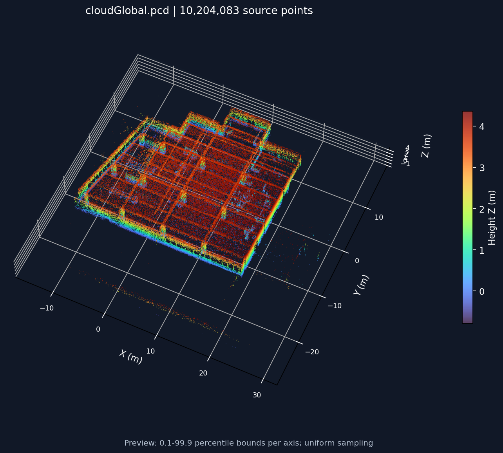

# MID360 Campus SLAM

基于 **ROS 2 Humble + Livox MID360** 的三维建图与重定位工程，包含 IMU 预积分、点云去畸变、ScanContext 回环、GTSAM 优化、全局重定位及二维栅格地图导出，并保留地面分割和 Nav2 配套代码。

## 效果与视频

[B 站：20 万平方米园区建图与重定位，七栋办公楼](https://www.bilibili.com/video/BV16svHBEEbm/) · [分享链接](https://b23.tv/aMlqhUX)

**UP 主：[白马探花123](https://space.bilibili.com/205346639)｜UID：205346639**，与提供的个人主页截图对应。

**需要 20 万平方米园区数据集，请在上述 B 站视频下留言，说明用途及所需数据格式。** 本仓库提供代码和效果预览，不包含完整园区数据集。

### 前 20 秒

[](docs/media/demo-first-20s.mp4)

[查看 / 下载前 20 秒 MP4（含原声）](docs/media/demo-first-20s.mp4) · [观看完整视频](https://www.bilibili.com/video/BV16svHBEEbm/)

### 视频封面与首帧截图

| B 站视频封面 | 视频首页（第 0 秒） |
| --- | --- |
| [](https://www.bilibili.com/video/BV16svHBEEbm/) |  |

### 本地地图样例

以下图片分别由提供的 `map_2d.pgm` 和 `cloudGlobal.pcd` 直接渲染，**属于本地小范围地图样例，不是上方视频中的完整园区地图**。

| 二维栅格地图 | 三维点云地图（按高度着色） |
| --- | --- |
|  |  |

二维地图：223 × 274 像素，分辨率 0.05 m；三维原始点云：801,159 点。三维预览抽样显示各坐标轴 0.1%～99.9% 分位范围内的主体，不修改原始点云。

### 补充地图：`maps.zip`

来自压缩包内同一目录的 `maps/slam_data/cloudGlobal.pcd` 和 `maps/slam_data/map_2d.pgm`：

| 二维切片地图 | 三维点云地图（按高度着色） |
| --- | --- |
|  |  |

原始点云 **10,204,083 点**；二维地图 **1155 × 776 像素**、0.05 m/像素，栅格范围约 **57.75 × 38.80 m**。三维预览使用与上方相同的抽样及显示范围设置；仓库仅收录预览图，完整 `maps.zip` 不随代码上传。

## 编译

环境：**Ubuntu 22.04、ROS 2 Humble、GTSAM 4.2、Livox-SDK2**。以下命令在已安装 ROS 2 Humble 的终端执行。

```bash
git clone https://github.com/zhuoligetu123/mid360-campus-slam.git
cd mid360-campus-slam
source /opt/ros/humble/setup.bash

sudo apt update
sudo apt install -y build-essential cmake git python3-colcon-common-extensions \
  python3-rosdep libgeographic-dev libboost-timer-dev libpcl-dev libopencv-dev \
  libeigen3-dev libapr1-dev ros-humble-gtsam ros-humble-ndt-omp \
  ros-humble-xacro ros-humble-robot-state-publisher ros-humble-rviz2

# 仅首次使用 rosdep 时需要 sudo rosdep init
rosdep update
rosdep install --from-paths src --ignore-src -r -y --rosdistro humble \
  --skip-keys "GTSAM OpenCV PCL Eigen Boost pcl eigen_conversions"
```

安装 [Livox-SDK2](https://github.com/Livox-SDK/Livox-SDK2)（已安装可跳过）：

```bash
git clone https://github.com/Livox-SDK/Livox-SDK2.git /tmp/Livox-SDK2
cmake -S /tmp/Livox-SDK2 -B /tmp/Livox-SDK2/build -DCMAKE_BUILD_TYPE=Release
cmake --build /tmp/Livox-SDK2/build -j2
sudo cmake --install /tmp/Livox-SDK2/build
sudo ldconfig

# 回到本仓库根目录编译
MAKEFLAGS=-j2 colcon build --symlink-install --parallel-workers 2 \
  --cmake-args -DROS_EDITION=ROS2 -DHUMBLE_ROS=humble \
  -DCMAKE_BUILD_TYPE=Release -DBUILD_TESTING=OFF
source install/setup.bash
```

## 运行

每个终端先执行 `source /opt/ros/humble/setup.bash` 和 `source install/setup.bash`。

### 1. 启动 MID360

修改 [`MID360_config.json`](src/livox_ros_driver2/config/MID360_config.json)：`host_net_info` 中各 IP 填电脑连接雷达的网口地址，`lidar_configs[0].ip` 填雷达地址；两者需在同一网段。默认示例为电脑 `192.168.1.100`、雷达 `192.168.1.136`。

```bash
ros2 launch livox_ros_driver2 msg_MID360_launch.py
# 检查输入：/livox/lidar 为 livox_ros_driver2/msg/CustomMsg
ros2 topic hz /livox/lidar
ros2 topic hz /livox/imu
```

使用其他配置时传入 `user_config_path:=/绝对路径/MID360_config.json`。雷达安装外参、IMU 参数需按实际设备修改 [`mapping 配置`](src/sc_liorf_localization/config/lio_sam_mid360_mapping.yaml) 和 [`localization 配置`](src/sc_liorf_localization/config/lio_sam_mid360_localization.yaml)。

### 2. 建图与保存

另开终端，使用**新的空目录**；路径用绝对路径、不要含空格，并以 `/` 结尾。

```bash
ros2 launch rm_bringup mapping.launch.py map_dir:="$HOME/mid360_maps/run01/"
```

建图完成后，在另一个已加载工作空间的终端保存：

```bash
ros2 service call /sc_liorf_localization/save_map \
  sc_liorf_localization/srv/SaveMap "{resolution: 0.2, destination: ''}"
```

`destination: ''` 使用启动时的 `map_dir`。保存成功后再退出建图；保留整个目录中的 `cloudGlobal.pcd`、`SCDs/`、`Scans/`、`optimized_poses.txt` 等文件。发布版的上述建图入口会拒绝覆盖非空目录。

### 3. 重定位

停止建图节点，保持雷达驱动运行，再加载同一地图目录：

```bash
ros2 launch rm_bringup localization.launch.py map_dir:="$HOME/mid360_maps/run01/"
```

仅有一份 `cloudGlobal.pcd` 不足以重定位，还需要对应的 ScanContext 描述子、关键帧点云和优化位姿。该入口启动重定位、地面分割及点云转激光扫描，**不会启动底盘运动控制**；Nav2 参数在 `src/robot_navigation2/`，接入底盘后再按实际 TF、话题和地图配置。

## 工程与验证

| 目录 | 用途 |
| --- | --- |
| `src/livox_ros_driver2` | MID360 雷达与 IMU 驱动 |
| `src/sc_liorf_localization` | 建图、回环、地图保存与重定位 |
| `src/rm_bringup` | 建图 / 重定位组合启动入口 |
| `src/linefit_ground_segementation_ros2`、`src/pointcloud_to_laserscan` | 地面分割与二维扫描输出 |
| `src/robot_navigation2`、`src/rplidar_ros2_driver`、`src/imu_complementary_filter` | 导航配置、二维雷达及 IMU 配套模块 |

本次发布已在本机 Ubuntu 22.04 / Humble 编译通过全部 9 个包。视频为既有实测展示；本次整理不代表重新完成园区采集或实车定位验证。

地图预览可用 `python3 tools/render_maps.py /地图目录` 重新生成（需要 NumPy、Matplotlib、Pillow）。

## 致谢与许可

基于 [LIO-SAM](https://github.com/TixiaoShan/LIO-SAM)、[LIORF](https://github.com/YJZLuckyBoy/liorf)、ScanContext、[Livox ROS Driver 2](https://github.com/Livox-SDK/livox_ros_driver2) 等开源工作整理，保留各子目录原有版权和许可证；各组件以其原始许可为准。
